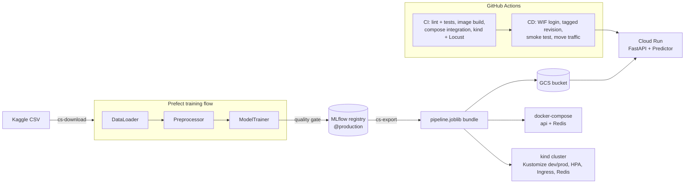

# Credit Scoring

Predicts the probability that a loan applicant will default, and serves that
prediction over HTTP. The project runs end to end: data analysis, model
training and selection, an object-oriented training pipeline orchestrated with
Prefect, a FastAPI service with a Redis cache, Docker and docker-compose, a
local Kubernetes cluster, and CI/CD to Google Cloud Run.

It is the final project of the Kodolamacz (Sages) "Inzynier AI" course. The
aim, per the course brief, is to work through every stage, not to build the
best possible model.

## Try it live

The service runs on Cloud Run:
<https://credit-scoring-api-150613394923.europe-central2.run.app>

```bash
curl https://credit-scoring-api-150613394923.europe-central2.run.app/health
# {"status":"ok"}

curl -X POST https://credit-scoring-api-150613394923.europe-central2.run.app/score \
  -H 'Content-Type: application/json' \
  -d '{"AMT_INCOME_TOTAL": 202500.0, "AMT_CREDIT": 406597.5, "AMT_ANNUITY": 24700.5, "DAYS_BIRTH": -9461, "DAYS_EMPLOYED": -637, "CODE_GENDER": "M", "NAME_CONTRACT_TYPE": "Cash loans"}'
# {"probability":0.14004893600940704,"decision":true,"threshold":0.08375253528356552}
```

- `decision: true` means "flag as a likely default": the probability is at or
  above the model's threshold.
- Every field is optional. Send the columns you have and the fitted pipeline
  imputes the rest. Unknown fields, `Infinity` and out-of-range flags are
  rejected with `422`.
- `POST /score/batch` takes `{"applications": [...]}` with up to 100 items.
- The interactive OpenAPI page is at
  [`/docs`](https://credit-scoring-api-150613394923.europe-central2.run.app/docs).
- **The first call after a quiet period takes about 7–12 s.** The service
  scales to zero and has to start a container and load the model. Calls after
  that take well under a second.
- Responses carry `x-cache: BYPASS` on Cloud Run, which has no Redis. In
  compose and on Kubernetes (or locally with `CS_REDIS_URL` set) they carry
  `MISS` or `HIT`.

## Problem and data

- **Dataset:** Kaggle [Home Credit Default
  Risk](https://www.kaggle.com/competitions/home-credit-default-risk),
  `application_train.csv` only: 307,511 applications × 122 columns.
- **Target:** `TARGET = 1` means the client defaulted. Only **8.07%** did, so a
  model that never predicts a default is 91.9% accurate and useless. The
  metrics that matter here are ROC-AUC, PR-AUC and recall on defaults.
- The data is downloaded programmatically and never committed. A contract test
  pins its shape, column names and types.

## Results

Same stratified 80/20 split throughout (`random_state=42`, 61,502 test rows,
4,965 defaulters).

| Model | Threshold | ROC-AUC | PR-AUC | Recall | Precision | Expected cost |
|---|---|---|---|---|---|---|
| Logistic regression (baseline) | 0.5 | 0.7515 | 0.2372 | 0.0119 | 0.5514 | 49,108 |
| XGBoost | 0.5 | 0.7684 | 0.2626 | 0.0310 | 0.6087 | 48,209 |
| **XGBoost (served)** | **0.0838** | **0.7684** | **0.2626** | **0.6743** | **0.1756** | **31,892** |

- **The threshold did more than the algorithm.** The decision threshold was
  chosen on out-of-fold training predictions under a stated assumption that a
  missed default costs 10× a false alarm. It took recall from 3% to 67% with
  no change to the model.
- Three algorithms × three imbalance strategies were compared. SMOTE lost to
  class weights on every algorithm. Class weights moved the operating point,
  not the ranking.
- 30 Optuna trials did not beat XGBoost's defaults. A quality gate plus an
  incumbent comparison keeps the worse model out of production.
- Nine engineered features (debt-to-income, credit term, bureau inquiry total,
  external-score mean and others) are computed inside the pipeline, so the API
  accepts raw columns.

## Architecture



- **Training side.** `DataLoader`, `Preprocessor`, `ModelTrainer` with a
  Strategy registry for the estimator and the imbalance handling. Prefect owns
  execution order, retries and result caching. MLflow owns runs and the
  registry.
- **Serving side.** A FastAPI app loads one exported bundle at startup and
  never imports MLflow. It has async endpoints, request-ID and timing
  middleware, one JSON event per request on stdout, and a Redis cache keyed on
  the payload and the model version.
- **The image is model-free.** The model arrives on a volume: a named volume
  in compose, `hostPath` on kind, a Cloud Storage mount on Cloud Run.
  `deploy/model-version` selects which registry version serves.

## Run it locally

Requires [uv](https://docs.astral.sh/uv/). Docker is needed for compose and
kind.

```bash
uv sync                      # restore the environment from uv.lock
uv run python verify_env.py  # library versions, GPU, whether the data is present
uv run cs-download           # download application_train.csv into data/raw/
```

`uv run cs-download` needs Kaggle credentials (`~/.kaggle/kaggle.json`, or the
variables in `.env.example`) **and** the [competition
rules](https://www.kaggle.com/competitions/home-credit-default-risk/rules)
accepted in a browser. Without the second, the API returns 403 even with valid
keys.

**Train and serve**

```bash
uv run cs-train       # Prefect flow: 3x3 model grid, champion, threshold, gate, registry
uv run cs-tune        # optional: Optuna search for the champion family
uv run cs-export      # registry @production -> models/pipeline.joblib
uv run cs-serve       # http://localhost:8080
```

No dataset? `uv run cs-synthetic-artifact --output models/pipeline.joblib`
fits the real pipeline on random rows, which is enough to start the service.
It is not a real model.

**docker-compose:** two profiles sharing a model volume. The `api` service
needs a model in that volume and exits at startup without one.

```bash
# With the dataset (after cs-download): train into the volume, then serve
docker compose --profile train --profile serve up --build   # MLflow, Prefect server, trainer, api + Redis on :8080

# Later runs reuse the filled volume
docker compose --profile serve up --build

# Without the dataset: a synthetic model on a bind mount (what CI runs)
uv run cs-synthetic-artifact --output /tmp/cs-model/pipeline.joblib
docker build --target serve -t credit-scoring/api:ci .
CS_MODEL_DIR=/tmp/cs-model docker compose -f docker-compose.yml \n  -f docker-compose.ci.yml --profile serve up --no-build
```

Behind a TLS-intercepting proxy, pass its CA bundle to the build:
`CS_CA_BUNDLE=$HOME/.ssl/cacert.pem docker compose --profile serve build`.

**Kubernetes on kind:** see [`deploy/k8s/`](deploy/k8s/) and
[`deploy/kind/`](deploy/kind/). Needs `kind` and `kubectl` installed, and a
model at `models/pipeline.joblib` (from `cs-export`, or
`cs-synthetic-artifact --output models/pipeline.joblib`).

```bash
deploy/kind/bootstrap.sh            # cluster, ingress-nginx, metrics-server
deploy/k8s/deploy.sh dev            # build, side-load, sync the model, apply, roll out
deploy/k8s/smoke.sh http://credit-dev.localtest.me credit-dev.localtest.me
deploy/k8s/operations-demo.sh dev   # rolling update, rollback, scaling, slow start
```

## Tests

```bash
uv run pytest
```

- Unit tests, Kubernetes manifest tests rendered from the overlays, and
  workflow tests for CI and CD.
- Tests marked `requires_data` skip without the CSV. `integration` tests skip
  when no stack is running. So a fresh clone passes with no data and no model.
- Integration tests against a running stack:
  `CS_INTEGRATION_BASE_URL=http://localhost:8080 uv run pytest tests/integration`.
- Load test:
  `uv run --group load locust -f tests/load/locustfile.py --host http://credit-dev.localtest.me`.
  `CS_LOAD_REPEAT_RATE` sets the share of repeated payloads, which is the
  cache hit rate.

## Where things are

| Path | What |
|---|---|
| [`notebooks/01-eda.ipynb`](notebooks/01-eda.ipynb) | EDA: distributions, missing data by cause, outliers, feature decisions |
| [`src/`](src/) | Data loading, features, strategies, trainer, Prefect flow, gate, registry |
| [`src/api/`](src/api/) | FastAPI app, schemas, middleware, events, cache |
| [`tests/`](tests/) | pytest suite, [`tests/integration/`](tests/integration/), [`tests/load/`](tests/load/) |
| [`Dockerfile`](Dockerfile) | Multi-stage build: `serve` and `trainer` targets |
| [`docker-compose.yml`](docker-compose.yml) | `serve` and `train` profiles |
| [`deploy/k8s/`](deploy/k8s/) | Kustomize base plus `dev` / `prod` overlays, operations scripts |
| [`deploy/cloudrun/deploy.sh`](deploy/cloudrun/deploy.sh) | Cloud Run deploy: tagged revision with no traffic |
| [`deploy/model-version`](deploy/model-version) | Registry version that serves in production |
| [`.github/workflows/ci.yml`](.github/workflows/ci.yml) | CI: lint and tests, image build, compose integration, kind + Locust gate |
| [`.github/workflows/cd.yml`](.github/workflows/cd.yml) | CD: Workload Identity Federation, smoke-gated traffic move |

## Known limitations

- **The model upload to Cloud Storage is manual.** The training flow exports
  the bundle; a person uploads it and bumps `deploy/model-version`.
- **No Redis on Cloud Run** (cost and networking). The cache is shown in
  compose and on kind.
- **855 MB image** (219 MB compressed). Every cold start pays for it. It was
  measured, not slimmed.
- The Kubernetes `prod` overlay is declared and smoke-tested, not load-tested.
  Load numbers come from a single laptop.
- Running CD by hand (`workflow_dispatch`) skips the green-CI check. The
  tip-of-`main` guard and the smoke gate still apply.
- The neural-network component (a CNN on document images and an RNN on
  application text) is still to come.
